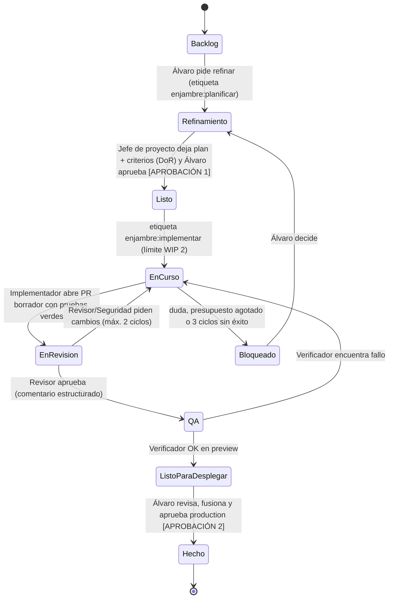

# Anexo B: arquitectura, especificaciones y seguridad

> Enjambre · [Plan principal](../PLAN.md) · [A Inventario](A-inventario.md) · [B Arquitectura](B-arquitectura.md) · [C Fichas](C-fichas-agentes.md) · [D Backlog](D-backlog.md) · [E Referencias](E-referencias.md)

## 5. Arquitectura y especificaciones técnicas

### 5.1 Diagrama de arquitectura (vía A+C)

```mermaid
flowchart LR
  subgraph Humano
    AL[Álvaro<br/>Propietario de producto<br/>y aprobador]
  end
  subgraph Planificacion["Planificación"]
    JI[Jira Cloud<br/>épicas e historias<br/>(opcional)]
    GI[GitHub Issues + Projects<br/>bus de ejecución]
  end
  subgraph Repo_enjambre["Repo enjambre (plugin)"]
    AG[.claude/agents/*.md]
    SK[skills/*]
    HK[hooks/*]
    EV[evals/*]
  end
  subgraph Ejecucion["Ejecución"]
    LOC[Sesión local Claude Code<br/>en devcontainer]
    GHA[GitHub Actions<br/>claude-code-action@v1]
  end
  subgraph Agentes
    JP[Jefe de proyecto]
    IM[Implementador]
    RV[Revisor]
    VQ[Verificador QA]
    PL[Plataforma y Entrega]
    SE[Seguridad]
    DA[Datos y BI]
  end
  subgraph Proyecto["Repo de proyecto (lobby, tracker…)"]
    BR[rama enjambre/*]
    PR[Pull request]
    CI[CI: lint, pruebas,<br/>CodeQL, secretos]
  end
  subgraph Cloudflare
    PV[Worker preview + D1 preview]
    PROD[Worker producción]
  end
  OBS[(Telemetría y coste<br/>JSONL + D1/Lobby)]

  AL -- prioriza / aprueba --> GI
  JI <-- app GitHub for Jira --> GI
  GI -- etiqueta/estado --> GHA
  AL -- abre sesión --> LOC
  Repo_enjambre -. plugin .-> LOC
  Repo_enjambre -. plugin .-> GHA
  LOC --> Agentes
  GHA --> Agentes
  JP -- plan, subtareas --> GI
  IM --> BR --> PR
  PR --> CI
  RV -- revisión --> PR
  SE -- revisión seguridad --> PR
  VQ -- verifica --> PV
  PL -- despliega preview --> PV
  AL -- aprueba entorno production --> PROD
  Agentes -. hooks .-> OBS
```

**Flujo de eventos (vida de una tarea):**



### 5.2 Fichas de agentes

Ver [Anexo C: fichas de agentes](C-fichas-agentes.md).

### 5.3 Integración con Jira (fase 2, si P1/P2 = sí)

- **Proyecto Jira:** `ENJ` (Enjambre) para la plataforma; un proyecto por producto (`LOB` lobby, `FIN` finance_tracker) o uno solo con componentes. Recomiendo **uno por producto** (Scrum o Kanban; propongo **Kanban** con límite WIP 2 en «En curso», porque no hay equipo humano ni cadencia de sprint obligatoria).
- **Tipos de issue (work items):** Épica (nivel 1) → Historia / Tarea / Bug (nivel 0) → Subtarea (nivel −1). Mapeo: **Épica = objetivo de producto**; **Historia = un PR de un Implementador**; **Subtarea = paso del plan (checklist), no un agente aparte**; **Bug = historia con reproducción**.
- **Flujo (estados):** Backlog → Refinamiento → Listo → En curso → En revisión → QA → Listo para desplegar → Hecho; transversal: Bloqueado.
- **Campos:** `Criterios de aceptación` (texto), `Agente asignado` (lista: jefe, implementador, revisor, verificador, plataforma, seguridad, datos), `Complejidad` (S/M/L), `Coste IA (USD)` (número), `PR` (vía app GitHub for Jira), `Repositorio` (componente).
- **Automatizaciones (cuidado: Free = 150 pasos/mes):** solo 2 reglas: (1) al pasar a «Listo», enviar `repository_dispatch` a GitHub; (2) al fusionar PR (evento de la app), pasar a «Listo para desplegar». El resto se hace desde GitHub (gratis).
- **Cómo escribe el Jefe de proyecto en Jira:** en sesión local, por el **MCP remoto de Atlassian** (`https://mcp.atlassian.com/v2/mcp`, OAuth 2.1 con tus permisos; herramientas de borrado desactivadas). En Actions, por API REST con token de API en secreto (el OAuth interactivo no sirve en CI).
- **Enlace Jira↔GitHub:** la clave (`LOB-123`) en nombre de rama, título de PR y commits; la app *GitHub for Jira* vincula automáticamente.
- **Importación inicial:** CSV de §8 (columnas `Work item ID`, `Work type`, `Summary`, `Parent`, `Priority`, `Description`), padres antes que hijos, UTF-8.
- **Alternativa sin Jira (MVP):** GitHub Issues con *issue types*/etiquetas equivalentes, sub-issues y un GitHub Project con los mismos estados.

### 5.4 Repositorios y flujo Git

- **Repos:** `enjambre` (plugin, docs, evaluaciones, plantillas, devcontainer base) + repos de producto existentes (que activan el plugin en `.claude/settings.json` con `extraKnownMarketplaces` y `enabledPlugins`).
- **Estructura de `enjambre`:**
  ```
  .claude-plugin/plugin.json, marketplace.json
  agents/        (jefe-proyecto, implementador, revisor, verificador, plataforma, seguridad, datos)
  skills/        (reglas-enjambre, planificar, backend-workers, frontend-web, rust-worker, pruebas,
                  documentar, git-enjambre, verificar-e2e, revisar-seguridad, informe-semanal)
  hooks/         (proteger-secretos, bloquear-comandos, registrar-coste, comprobar-alcance, stop-verificar)
  templates/     (plan.md, pr.md, adr.md, informe-qa.md, workflows/*.yml, devcontainer/)
  evals/         (tareas/, graders/, resultados/)
  docs/          (PLAN.md, anexos/, decisiones/, operacion.md)
  ```
- **Estrategia:** *trunk-based* / GitHub flow: `main` siempre desplegable; ramas cortas `enjambre/<clave>-<slug>` (agentes) y `alvaro/*` (tú); vida < 2 días.
- **PRs:** siempre en borrador al abrir; plantilla con Resumen, Issue, Cómo se probó, Riesgos, Checklist DoD, Coste IA. ≤ 400 líneas.
- **Revisión:** Revisor (agente) + Seguridad cuando toque + **tu aprobación obligatoria** para fusionar.
- **Protección de `main` (ruleset):** PR obligatorio, 1 aprobación de CODEOWNER (tú), descartar aprobaciones al hacer push, checks obligatorios (lint, pruebas, CodeQL), historial lineal, sin *force push*, bypass solo tú. `CODEOWNERS` protege `.github/`, `.claude/`, `wrangler.toml`, `migrations/`.
- **Commits:** Conventional Commits 1.0.0 en inglés, sin `Co-Authored-By`; autor = bot; trailer opcional `Enjambre-Agente: implementador` (P10). SemVer para el plugin.

### 5.5 CI/CD, entornos, IaC y secretos

| Entorno | Qué es | Quién despliega | Datos |
|---|---|---|---|
| Local | `wrangler dev` en devcontainer | Agentes / tú | BD local sintética |
| Preview | Worker `lobby-preview` + D1 `lobby-preview` (o *preview URLs* de Workers) | Plataforma (workflow automático por PR) | Datos de prueba generados |
| Producción | Worker `lobby` + D1 `lobby` | **Solo workflow protegido tras tu aprobación** o tú con `npm run deploy` | Reales |

- **CI (por PR):** `npm ci` → `npm run check` → pruebas unitarias → `wrangler deploy --env preview` → Playwright contra preview → CodeQL → secret scanning → comentario de coste IA.
- **CD:** `workflow_dispatch` o fusión a `main` → entorno `production` con revisor requerido (tú) → `wrangler d1 migrations apply` + `wrangler deploy` → prueba de humo → posibilidad de *rollback* (`wrangler rollback` + D1 Time Travel).
- **IaC:** `wrangler.toml` con `[env.preview]` y `[env.production]` como fuente de verdad; Terraform **no** (sobredimensionado para 2 Workers).
- **Endurecimiento de Actions:** `permissions: contents: read` por defecto; OIDC donde se pueda; acciones fijadas por SHA o lockfile `actions.lock`; entradas no confiables solo por variables de entorno; nada de `pull_request_target` con código del PR; Dependabot para acciones.
- **Secretos:** solo en GitHub Secrets por entorno y `wrangler secret`; nunca en repo; los agentes no pueden leer `.env`/`.dev.vars` (reglas `deny` + hook); contraseñas de lobby solo tú (`npm run clave`).

### 5.6 Datos y BI (fase 4)

- **Plataforma:** D1 (operacional, ya existe) → exportación diaria a **R2 / Basin Catalog (Iceberg)** si el volumen lo justifica [requiere activar R2; Basin Pipelines requiere Workers Paid]. Para volumen personal, **DuckDB** en devcontainer o GitHub Actions leyendo exportaciones de D1 es suficiente y gratis.
- **Pipelines:** ingesta idempotente con `clave_origen`; capas bronce (bruto) / plata (limpio) / oro (marts en estrella); transformaciones con **dbt Core + DuckDB**; pruebas dbt y contratos de modelo.
- **Modelo de datos inicial (Enjambre mismo):** `hechos_ejecucion_agente` (tarea, agente, modelo, tokens, coste, duración, resultado) + dimensiones `agente`, `tarea`, `repositorio`, `fecha`. Primer caso de uso real de BI: el **panel de Enjambre**.
- **BI:** opción 1 **módulo de Lobby** (reutiliza Worker+D1, coste 0; P13); opción 2 **Evidence (core, código abierto)** generado estático; opción 3 **Data Studio** (antes Looker Studio, gratuito) o **Power BI Desktop** (lo conoces). Recomiendo 1 para el panel operativo y Power BI/Evidence para análisis.

### 5.7 Pruebas y QA

- **Estrategia:** pirámide para la lógica (unitarias rápidas, p. ej. `node:test` en JS, `cargo test` en Rust) + **trofeo** en la capa web (énfasis en integración/E2E con Playwright, como ya hace lobby). Discrepancia entre fuentes (pirámide frente a trofeo): recomiendo la pirámide para backend y el trofeo para la SPA porque lobby no tiene framework de componentes y su valor está en los flujos.
- **Automatización:** pruebas en cada PR; Playwright contra preview; prueba de humo tras producción.
- **Criterios de aceptación:** Dado/Cuando/Entonces, cada uno comprobable por el Verificador.
- **Definición de Listo (DoR):** objetivo, criterios, plan técnico, estimación ≤ M, dependencias resueltas, aprobada por ti.
- **Definición de Hecho (DoD):** CI verde; pruebas nuevas para el cambio; Revisor `APROBAR`; Verificador `PASA` con evidencias; docs actualizadas; sin secretos; coste IA registrado; aprobación y fusión por ti; desplegado (o marcado para despliegue).
- **Opcional fase 5:** pruebas de mutación (Stryker) en módulos críticos para medir la calidad de las pruebas que escriben los agentes.

### 5.8 Memoria y contexto compartido

- **CLAUDE.md** de cada repo (< 200 líneas) con reglas y comandos; el plugin aporta `skills/reglas-enjambre` común.
- **Documentos de área** (patrón finance_tracker): `docs/<area>/CONTEXTO.md` que cada agente actualiza al cerrar.
- **ADR:** `docs/decisiones/AAAA-MM-DD-titulo.md` con plantilla existente; el Jefe de proyecto los consolida.
- **Estado por tarea:** el issue es la memoria (plan, decisiones, informes). En ejecuciones en frío (Actions), el agente empieza leyendo el issue y el PR.
- **Memoria de subagente** (`memory: project`) solo para Revisor y Verificador (aprendizajes recurrentes), revisada por ti mensualmente (OWASP ASI06, envenenamiento de memoria).
- **Etiquetas de certeza** en documentos: Confirmado / Documentado / Inferido / Propuesta / Pendiente (de finance_tracker).

### 5.9 Observabilidad

- **Registro por ejecución:** hook `PostToolUse`/`Stop`/`SubagentStop` que escribe JSONL (`agente`, `tarea`, `herramienta`, `decision`, `duracion`); en Actions, salida `--output-format json` con `total_cost_usd` y `session_id` como artefacto y comentario en PR.
- **Telemetría:** OpenTelemetry de Claude Code (`CLAUDE_CODE_ENABLE_TELEMETRY=1`; métricas `claude_code.cost.usage`, `token.usage`, `pull_request.count`, `commit.count`; eventos `tool_decision`, `api_request`). Contenido de prompts **redactado** por defecto (mantenerlo así). Trazas en beta: no depender de ellas.
- **Convenciones:** atributos `gen_ai.*` de OpenTelemetry están en estado *Development*; fijar versión antes de construir encima.
- **Métricas clave:** coste por tarea y por agente; tokens; tiempo de ciclo; ciclos de revisión; tasa de PRs aceptados sin retrabajo; tasa de bloqueo.
- **Nota:** `total_cost_usd` es una **estimación del cliente**, no facturación; conciliar mensualmente con Console o con el uso de la suscripción.

### 5.10 Estimación de coste por historia (a validar en fase 0)

Supuesto de historia pequeña (S/M) con Sonnet 5.5 implementando: ~2 M tokens de entrada (90 % lecturas de caché a 0,05×) y ~100 k de salida → ~0,18 $ + 0,40 $ + 1,00 $ ≈ **1,6 $**. Plan (Opus) + revisión (Opus) + verificación (Sonnet) añaden ~1–3 $; con ciclos de corrección, **2–8 $ por historia** a precio de API. Con suscripción, el coste marginal es 0 pero consume límites de uso. Referencia de Anthropic: media de ~13 $ por desarrollador y día activo con Claude Code.

## 6. Seguridad, control y gobernanza

### 6.1 Permisos por agente (regla de dos de Meta: como máximo 2 de [A] entrada no confiable, [B] datos sensibles, [C] cambiar estado/comunicar fuera)

| Agente | A: lee contenido no confiable | B: datos sensibles | C: cambia estado / externo | Cumple |
|---|---|---|---|---|
| Jefe de proyecto | Sí (issues) | No | Sí (tablero) | ✔ (sin B) |
| Implementador | Limitado (issue ya refinado) | No | Sí (rama, PR) | ✔ |
| Revisor | Sí (diff) | No | Solo comentar | ✔ |
| Verificador | Sí (app) | No (datos sintéticos) | Solo preview | ✔ |
| Plataforma | No (sin web libre) | Secretos de preview | Sí (preview) | ✔ |
| Seguridad | Sí | Alertas | Solo comentar | ✔ |
| Datos | No | Muestras | BD de pruebas | ✔ |

### 6.2 Acciones permitidas, prohibidas y con aprobación humana

| Siempre prohibido para agentes | Siempre requiere tu aprobación | Permitido |
|---|---|---|
| `wrangler deploy` a producción, `d1 execute --remote` en producción, `git push --force`, `gh repo delete`, borrar ramas protegidas, leer `.env`/`.dev.vars`/`datos/**`/credenciales, cambiar rulesets, cambiar `.claude/settings*.json` o hooks desde una tarea, instalar servidores MCP o plugins no listados, `WebFetch` fuera de lista blanca, `bypassPermissions` fuera de contenedor, gastar dinero o crear cuentas | Pasar historia a «Listo», fusionar PR, despliegue a producción, migraciones de producción, cambios en permisos/hooks/agentes, nuevas dependencias de producción, acceso a datos reales, superar presupuesto, borrar datos | Leer código, crear ramas `enjambre/*`, commits, PR en borrador, comentar, ejecutar pruebas, desplegar a preview, actualizar issues |

Implementación: reglas `deny` en `settings.json` gestionado por el plugin + hook `PreToolUse` (`bloquear-comandos`, `proteger-secretos`) con código de salida 2 + rulesets/CODEOWNERS en GitHub + entorno `production` con revisor requerido + permisos mínimos de la GitHub App + `allowed_non_write_users` vacío en la Action.

### 6.3 Secretos, aislamiento, inyección, auditoría

- **Secretos:** GitHub Secrets por entorno; `wrangler secret`; tokens de agentes con caducidad y alcance mínimo; rotación trimestral; *secret scanning* y *push protection* activados.
- **Aislamiento:** devcontainer (Docker) o WSL2 con *sandbox* de Claude Code (`sandbox.enabled`, `failIfUnavailable`, `allowUnsandboxedCommands: false`, `allowedDomains` mínimo: npm, github, cloudflare, docs); en Actions, el *runner* efímero ya aísla. Worktree por tarea.
- **Inyección de instrucciones (OWASP LLM01, ASI01):** todo contenido de issues, PR, webs y correos se trata como datos; solo usuarios con escritura disparan agentes; el Implementador trabaja desde el **plan aprobado por ti**, no desde texto libre de terceros; sin agente con la tríada letal; listas blancas de dominios; filtro de caracteres ocultos en entradas (hook); los agentes no pueden modificar sus propias reglas.
- **Auditoría:** cada acción queda en issue/PR/commit + logs JSONL + logs de Actions (90 días) + auditoría de Atlassian; informe semanal.

### 6.4 Control de costes

- Límites por ejecución: `--max-turns` (p. ej. 30 implementador, 15 revisor), `--max-budget-usd` (p. ej. 3 $ revisor, 8 $ implementador), `maxTurns` en frontmatter.
- Límite de gasto mensual en Console (workspace `enjambre`) si se usa API; recordar que el *Default Workspace* no cuenta todo.
- WIP 2; `concurrency` en workflows; sin ejecuciones programadas costosas salvo evaluaciones semanales.
- Alertas: hook que avisa cuando el coste acumulado del mes > 70 % del presupuesto; tarea que pasa a `Bloqueado` al agotar su presupuesto.
- Optimizaciones: caché de prompts (CLAUDE.md y skills estables), Haiku para exploración, Batch API (−50 %) para evaluaciones.

### 6.5 Evaluación de calidad y corrección de errores recurrentes

- **Banco de evaluaciones** (`evals/`): 20–50 tareas reales de lobby/finance_tracker (bugs resueltos, historias pasadas) con verificadores ejecutables; se ejecutan antes de cambiar prompts, modelos o versión de CLI; métricas pass@1 y pass^3.
- **Revisión humana por muestreo:** 100 % de PRs en MVP; 1 de cada 3 cuando la tasa sin retrabajo > 70 % durante 4 semanas (nunca 0 % en producción).
- **Errores recurrentes:** cada defecto escapado genera (1) prueba de regresión, (2) entrada en `docs/lecciones.md`, (3) ajuste de skill/prompt o hook determinista, (4) tarea en `evals/`. Retro mensual con informe del Jefe de proyecto.
