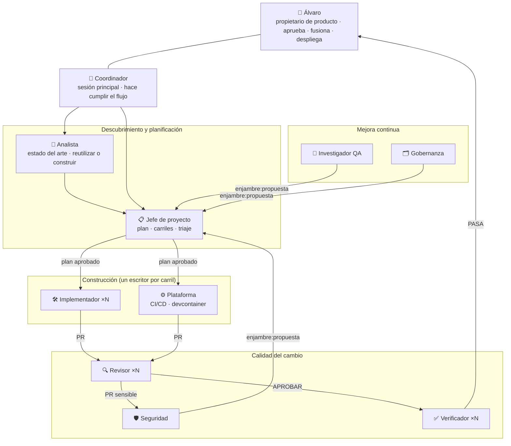

# Organigrama de Enjambre: roles, relaciones y arnés

> Estado a 21-11-2026. Decisiones de origen: [ADR 0003](decisiones/0003-equipo-ampliado-y-paralelo.md), [0004](decisiones/0004-bash-por-agente.md), [0005](decisiones/0005-cierre-f1-y-ci-cd.md) y [0006](decisiones/0006-repo-publico-y-organigrama.md). Las definiciones vigentes están en `plugins/enjambre/agents/`.

## 1. La idea en una frase

Enjambre funciona como una empresa pequeña de software: **Álvaro dirige y aprueba**, un **coordinador** hace cumplir el proceso, y cada historia la escribe **un solo agente**, rodeado de agentes que investigan, planifican, revisan, verifican y auditan. Se comunican por **artefactos** (issue, informe, plan, PR, veredicto), no por conversación libre.

## 2. Organigrama

## 3. Los diez agentes

| Agente | Misión | Recibe | Entrega | Escribe código | Bash | Web | Modelo | Turnos | Aislamiento |
|---|---|---|---|---|---|---|---|---|---|
| **Coordinador** | Hacer cumplir el flujo y el tablero | issue, órdenes de Álvaro | tablero de carriles, avisos de puerta | no | lista blanca | no | sonnet | 30 | — |
| **Analista** | Investigar antes de construir | petición | informe de investigación | no | lista blanca | **sí** | sonnet | 25 | — |
| **Jefe de proyecto** | Plan, carriles, triaje | issue + informe | plan, tabla de carriles, ADR propuesto | no | lista blanca | no | **opus** | 20 | — |
| **Implementador** ×N | Ejecutar un plan | plan aprobado | rama + PR en borrador | **sí** | completo* | no | sonnet | 30 | worktree |
| **Plataforma** | CI/CD y entorno | plan aprobado | rama + PR de workflows | **sí** | completo* | no | sonnet | 25 | worktree |
| **Revisor** ×N | Revisión independiente | PR + plan | veredicto APROBAR/CAMBIOS/BLOQUEAR | no | lista blanca | no | **opus** | 15 | — |
| **Seguridad** | Revisión de seguridad y auditorías | PR sensible | veredicto con referencia OWASP | no | lista blanca + auditorías | no | sonnet | 15 | — |
| **Verificador** ×N | Comprobar criterios ejecutando | PR aprobado | informe PASA/FALLA con evidencias | solo pruebas | completo* | no | sonnet | 25 | — |
| **Investigador** | QA exploratorio | alcance | issues `enjambre:propuesta` + patrones | no | lista blanca + pruebas | no | sonnet | 25 | — |
| **Gobernanza** | Orden y gobierno de código y datos | repositorio | informe 0–3 por área + propuestas | no | lista blanca + auditorías | no | sonnet | 20 | — |

\* «Completo» sigue limitado por `bloquear-comandos`, `proteger-secretos`, las reglas `deny` y el sandbox.

## 4. Relaciones: quién pasa qué a quién

| De | A | Artefacto | Dónde vive |
|---|---|---|---|
| Álvaro | Coordinador / Analista | petición | issue |
| Analista | Jefe | informe de investigación | comentario del issue → `docs/investigacion/` |
| Jefe | Álvaro | plan + tabla de carriles | comentario del issue |
| Álvaro | Implementador | **aprobación del plan** (puerta 1) | etiqueta `enjambre:implementar` |
| Implementador / Plataforma | Revisor | PR en borrador | GitHub |
| Revisor | Implementador | hallazgos (máx. 2 ciclos) | comentario del PR |
| Revisor | Seguridad | PR sensible | etiqueta / coordinador |
| Revisor | Verificador | APROBAR | comentario del PR |
| Verificador | Álvaro | informe QA + «Para el implementador» | comentario del PR |
| Álvaro | `main` | **fusión** (puerta 2) | GitHub |
| Investigador, Seguridad, Gobernanza | Jefe | propuestas | issues `enjambre:propuesta` |
| Jefe | Álvaro | triaje de propuestas | comentario |

Reglas de relación:
1. **Nadie da órdenes a otro agente**: el coordinador lanza; los demás entregan artefactos.
2. **Un escritor por historia**; los demás solo leen y comentan.
3. **Toda propuesta pasa por el jefe y la decide Álvaro**: los agentes no se generan trabajo a sí mismos.
4. **Escalado**: más de 2 ciclos de cambios, un `BLOQUEAR`, un límite de uso o una pregunta que bloquea → se para el carril y se avisa a Álvaro.

## 5. RACI

R = lo hace · A = responde (aprueba) · C = consultado · I = informado.

| Actividad | Álvaro | Coord. | Analista | Jefe | Impl. | Plat. | Revisor | Seg. | Verif. | Invest. | Gob. |
|---|---|---|---|---|---|---|---|---|---|---|---|
| Investigar estado del arte | A | I | R | C | | | | | | | |
| Plan y carriles | A | I | C | R | C | C | | | | | |
| Implementar historia | A | I | | C | R | | | | | | |
| CI/CD y entorno | A | I | | C | | R | | C | | | |
| Revisión de código | A | I | | | C | C | R | C | | | |
| Revisión de seguridad | A | I | | | | | C | R | | | |
| Verificación | A | I | | | C | | | | R | | |
| Fusionar y desplegar | **R/A** | I | | | | | | | | | |
| QA exploratorio | A | I | | C | | | | | | R | |
| Auditoría de gobernanza | A | I | | C | | | | | | | R |
| Triaje de propuestas | A | I | | R | | | | | | C | C |

## 6. El arnés aplicado a cada agente

Lo que define el comportamiento no es solo el prompt. Cada agente se controla con estas piezas (skill `arnes-claude-code`):

| Pieza del arnés | Cómo se aplica en Enjambre |
|---|---|
| **Herramientas** | `tools` explícito en los diez; Edit/Write solo en implementador, plataforma y verificador; web solo en el analista |
| **Bash** | hook `limitar-bash` con lista blanca para coordinador, analista, jefe, revisor, seguridad, investigador y gobernanza |
| **Secretos y comandos peligrosos** | hooks `proteger-secretos` y `bloquear-comandos` para todos, también dentro de subagentes |
| **Modelo** | Opus en jefe y revisor; Sonnet en el resto |
| **Turnos** | `maxTurns` entre 15 y 30 |
| **Aislamiento** | worktree para quien escribe; devcontainer o runner efímero para todo |
| **Contexto** | skills precargadas por rol; encargos con alcance cerrado; artefactos de entrada |
| **Verificación** | pruebas en el plan; verificador ejecuta; revisor independiente con otro modelo |
| **Salida estructurada** | plantillas: investigación, plan, PR, veredicto, informe QA, gobernanza, ADR |
| **Observabilidad** | hook `registrar-actividad` (inicio y fin de cada agente en `actividad.jsonl`); `bloqueos.jsonl` |
| **Disparo** | local: coordinador; CI: etiquetas que solo pone el propietario |

## 7. Ecosistema: plugins, MCP y visualización

| Pieza | Para qué | Quién la usa | Estado |
|---|---|---|---|
| Plugin **enjambre** (este repo, marketplace público `AlvaroM99/enjambre-publico`) | agentes, skills, hooks | todos | hecho |
| **context7**@claude-plugins-official | documentación actual de bibliotecas (evita APIs inventadas) | analista, implementador, jefe | en la plantilla de settings |
| **playwright**@claude-plugins-official | navegador para pruebas de extremo a extremo | verificador, investigador | en la plantilla de settings |
| **github**@claude-plugins-official | MCP oficial de GitHub | opcional; hoy se usa `gh` | documentado |
| **security-guidance**@claude-plugins-official | avisos de seguridad en cada edición | opcional para el implementador (gasta tokens al parar) | documentado |
| **plugin-dev**, **skill-creator** | mantener el propio plugin | Álvaro | documentado |
| **Pixel Agents** (pixel-agents-hq/pixel-agents, MIT) | ver a los agentes como personajes en una oficina de píxeles; los subagentes aparecen como personajes propios | Álvaro | instrucciones en [operación](operacion.md#oficina-de-agentes-pixel-agents) |
| GitHub Actions + `claude-code-action` | mismos agentes por eventos | CI | plantillas en la skill `ci-cd` |

Notas:
- Los agentes de un plugin **no pueden declarar** `mcpServers`; los MCP se activan a nivel de proyecto (plantilla de settings) y los agentes que tienen `tools` explícito solo los ven si se añaden sus nombres a `tools` [POR CONFIRMAR los nombres exactos en la prueba de humo].
- Pixel Agents lee las sesiones de Claude Code en local; no cambia Claude Code ni el repositorio.

Fuentes: https://github.com/anthropics/claude-plugins-official · https://github.com/upstash/context7 · https://github.com/microsoft/playwright-mcp · https://github.com/pixel-agents-hq/pixel-agents

## 8. Qué copiamos del estándar de la industria

| Práctica | De dónde | En Enjambre |
|---|---|---|
| Un escritor y asesores | Cognition, «Don't build multi-agents» | un implementador por carril |
| Exploración → arquitectura → implementación → revisión | plugin oficial `feature-dev` de Anthropic | analista → jefe → implementador → revisor |
| Revisión con puntuación de confianza para evitar falsos positivos | plugin oficial `code-review` | revisor: «un falso positivo cuesta tanto como un fallo no visto» |
| Rama propia, PR en borrador, el agente no aprueba su PR | GitHub Copilot coding agent | ramas `enjambre/*`, PR en borrador, `--approve` bloqueado |
| Documentos estructurados entre roles | MetaGPT | plantillas de artefactos |
| Regla de dos | Meta, Simon Willison | solo el analista lee la web y no escribe código ni ve secretos |
| Evaluar antes de cambiar prompts | Anthropic, «Demystifying evals» | banco de evaluaciones (S28) |

## 9. Lo que se ha descartado a propósito

- **Agent teams** de Claude Code (agentes que se mandan mensajes): experimental y caro (plan, D19).
- **Un jefe que asigna trabajo en tiempo real**: el coordinador sigue un flujo fijo y no prioriza (D5).
- **Agentes de datos/BI**: hasta que haya un proyecto de datos (F4).
